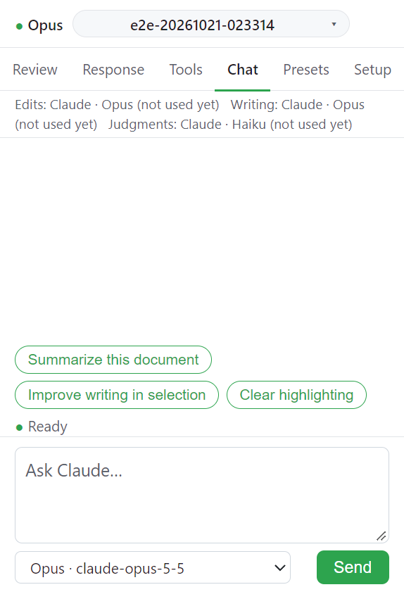

# Chat

Chat 탭은 열린 문서에 대해 자유롭게 묻고 시키는 대화창이다. 에이전트는 내 Claude Code 이고 문서 도구로 Word 를 읽고 고친다.

## 입력

| 항목                    | 내용                                                                                                                  |
| ----------------------- | --------------------------------------------------------------------------------------------------------------------- |
| 입력 칸 (`Ask Claude…`) | 요청                                                                                                                  |
| 모델 선택               | `Haiku · cheapest`, `Sonnet · balanced`, `Opus · most capable`. 계정이 쓸 수 있는 모델 목록이 오면 그 목록으로 바뀐다 |
| 선택 영역 칩            | Word 에서 선택한 텍스트가 `Selection: "..."` 로 붙는다. **×** 를 누르면 선택을 맥락으로 쓰지 않는다                   |
| 빠른 칩                 | 고정한 프리셋([Presets](presets.md))                                                                                  |

## 동작

1. 요청을 쓰고 **Send** 를 누른다.
2. 진행 표시가 `Ready` 에서 `Working…` 으로 바뀌고 도구 호출마다 `Reading the document…`, `Editing text…` 같은 줄이 뜬다.
3. 멈추려면 **Stop** 을 누른다.

## 요청 예

- _"Summarize this contract in plain English."_
- _"Improve the writing in the selection. Use track changes."_
- _"Review the Background section. Highlight anything weak in yellow and leave a comment explaining why."_
- _"Rewrite the Methodology section using the terminology in `~/Research/glossary.md`."_

## 문서 도구

Word 도구는 26개다. 문단 읽기와 바꾸기, 표, 강조, 주석, 목록, 그림, 하이퍼링크, 책갈피, 찾기, 머리글/바닥글을 다룬다. 모두 Office.js 로 동작하고 쓰기 도구는 모두 Track changes 설정을 따른다([Preferences](../settings/preferences.md)).

에이전트는 열린 `.docx`/`.docm`/`.xlsx`/`.xlsm` 파일에 파일 시스템으로 쓰지 않는다. 그런 쓰기는 거부되고 문서 도구를 써야 한다. 읽기는 허용된다. 이 장치는 사고 방지용이지 보안 경계가 아니다([보안과 개인 정보](../reference/security.md)).

## Slash commands

입력 칸에 `/<명령>` 을 쓰면 내 사용자 명령이 터미널에서처럼 돈다. 워크스페이스의 `.claude/commands/*.md` 나 `~/.claude/commands/*.md` 에 있는 명령이다. `/help`, `/context`, `/clear` 처럼 터미널 전용인 내장 명령은 채팅에 출력을 내지 않는다. 실행은 됐다는 한 줄 안내가 뜬다.

## 모델이 요청을 거절할 때

Edits 의 모델이 요청을 거절하면 Claude Code 가 다른 모델로 다시 돌린다. 다음 턴은 고른 모델에 다시 묻는다. 또 거절하면 내가 모델을 다시 고를 때까지 다른 모델에 머문다. 탭 아래 모델 줄과 Setup 이 이 사실을 알린다.

## 다음

→ [Presets](presets.md)
