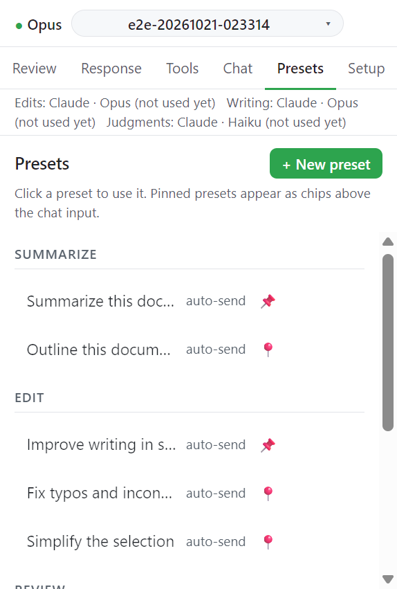

# Presets

프리셋은 한 번 눌러 보내는 프롬프트다. Word 와 Excel 은 각자 프리셋을 가진다.

## 동작

1. Presets 탭에서 프리셋을 누르면 쓴다.
2. 새로 만들려면 **+ New preset** 을 누른다.
3. 고정한 프리셋은 채팅 입력 칸 위에 칩으로 뜬다.

## 프리셋 편집 창

| 항목                                    | 내용                                                               | 필수 |
| --------------------------------------- | ------------------------------------------------------------------ | ---- |
| Title                                   | 이름. 예: `Summarize this document`                                | 필수 |
| Prompt                                  | Claude 에 보낼 내용. 여러 줄 가능                                  | 필수 |
| Category                                | `Summarize`, `Edit`, `Research`, `Review`, `Format` 또는 직접 입력 | 선택 |
| Send immediately on click               | 켜면 누르는 즉시 보낸다. 끄면 입력 칸만 채운다                     | 선택 |
| Pin to quick-chips above the chat input | 채팅 위 칩으로 고정                                                | 선택 |

## Word 기본 프리셋

| 프리셋                        | 하는 일                           |
| ----------------------------- | --------------------------------- |
| Summarize this document       | 처음부터 끝까지 읽고 요약         |
| Outline this document         | 제목 개요와 절별 문단 수          |
| Improve writing in selection  | 선택 영역을 다듬는다. 추적된 변경 |
| Fix typos and inconsistencies | 훑고 강조한 뒤 채팅에 요약        |
| Simplify the selection        | 쉬운 말로 다시 쓴다. 추적된 변경  |
| Add comments on this section  | 검토 모드. 본문은 고치지 않는다   |
| Answer using my context files | 추가한 폴더와 파일을 써서 답한다  |
| Clear highlighting            | 모든 강조를 한 번에 지운다        |

## Excel 기본 프리셋

| 프리셋                        | 하는 일                                      |
| ----------------------------- | -------------------------------------------- |
| Summarize this sheet          | 시트 목록, 사용 범위 읽기, 요약              |
| Explain the selected range    | 선택 범위의 내용과 패턴                      |
| Add a totals row              | `=SUM()` 수식을 쓴 Total 행                  |
| Check the data for problems   | 빈칸, 불일치, 중복을 나열한다. 고치지 않는다 |
| Find a value                  | 값 찾기                                      |
| Answer using my context files | 추가한 폴더와 파일을 써서 답한다             |

기본값은 저장소의 `taskpane/shared/taskpane.js` (`defaultWordPresets` / `defaultExcelPresets`)에 있다.

## 다음

→ [Excel](excel.md)
