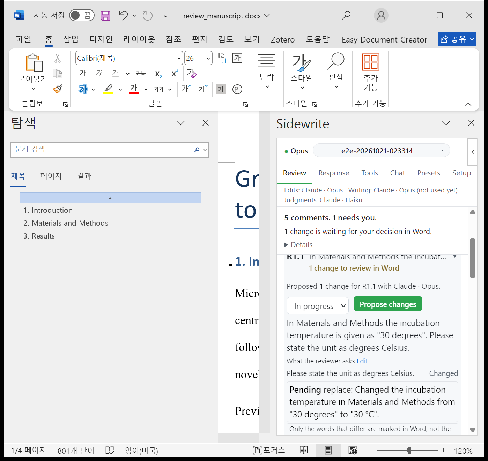

# Sidewrite 사용 가이드

Sidewrite 는 Word 와 Excel 의 작업창(task pane)에서 내 컴퓨터의 Claude Code 를 쓰게 해 주는 추가 기능이다. 작업창의 에이전트는 열린 문서를 읽고 고치며 주석을 달고 셀과 수식을 쓴다.

Word 작업창에는 원고 리비전 흐름이 들어 있다. 심사 의견을 의견 단위로 나누고 의견마다 변경을 추적된 변경(tracked change)과 근거 주석으로 제안한다. 수락과 거절은 Word 에서 직접 한다. 수락한 변경으로 응답서(response letter)를 쓰고 그림 기록과 제출 전 점검까지 같은 작업창에서 마친다.



## 공식 Claude for Word/Excel 과 다른 점

Anthropic 은 공식 추가 기능 **Claude for Word and Excel** 을 따로 배포한다. 설치가 필요 없고 Anthropic 이 지원한다. Sidewrite 는 설치가 더 번거로운 대신 내 컴퓨터의 Claude Code 를 그대로 쓴다.

|                 | 공식 Claude for Word/Excel                                                                     | Sidewrite                                                                                                                      |
| --------------- | ---------------------------------------------------------------------------------------------- | ------------------------------------------------------------------------------------------------------------------------------ |
| 쓸 수 있는 자료 | 열려 있는 Office 문서, 첨부한 다른 Excel/PowerPoint 파일, Claude 계정에 설정한 커넥터와 Skills | 내 컴퓨터의 임의 폴더와 파일. `Read`/`Glob`/`Grep`/`Bash` 로 필요할 때 읽는다                                                  |
| 누구의 Claude   | 독립된 Claude 환경                                                                             | 내 Claude Code. 워크스페이스의 `CLAUDE.md` 와 `.claude/settings.json` 이 기본으로 적용되고 사용자 수준 설정은 환경 변수로 켠다 |
| 코드            | 비공개                                                                                         | 공개. 작업창 UI, 도구, 프리셋, 시스템 프롬프트를 직접 고칠 수 있다                                                             |
| 인증            | Claude 계정                                                                                    | 로컬 Claude Code OAuth 또는 `ANTHROPIC_API_KEY`                                                                                |
| 사용량          | 구독의 일반 대화 사용량                                                                        | 프로그램 방식 사용량. 2026-06-15 부터 요금제의 월간 프로그램 사용 크레딧에서 차감된다                                          |
| 설치와 지원     | 설치 불필요, 공식 지원                                                                         | Claude Code 설치, 트레이 앱 실행, 추가 기능 사이드로드. macOS 가 먼저였고 Windows 는 더 새롭다. 1인용 로컬 도구다              |

두 도구 모두 모델이 답하는 데 필요한 문서 내용을 Anthropic API 로 보낸다. 차이는 조율, 파일 접근, 도구 실행이 어디서 일어나느냐다. Sidewrite 에서는 이 일이 모두 내 컴퓨터에서 일어난다.

## 구성 (텍스트 다이어그램)

```
┌─ 내 컴퓨터 ─────────────────────────────────────────────┐
│                                                         │
│   Tray app  ─►  Daemon  ◄──WebSocket──►  Task pane      │
│   (Electron)    (Node)                   (Word/Excel)   │
│                   │                                     │
│                   │ ~/.claude.json 의 MCP 서버 전달      │
│                   ▼ (선택, 기본 꺼짐)                    │
│              다른 MCP 서버                               │
└───────────────────┬─────────────────────────────────────┘
                    │ Claude Agent SDK (로컬 OAuth 또는 API key)
                    ▼
            ┌───────────────┐
            │ Anthropic API │
            └───────────────┘
```

1. **Tray app** (Electron): daemon 을 띄우고 감시한다. 추가 기능을 설치하고 제거하며 파일 선택 창을 연다.
2. **Daemon** (Node): Claude Agent SDK 로 로컬 Claude Code 를 터미널 없이 돌린다. Word/Excel 도구를 MCP 서버로 등록하고 작업창과 WebSocket 으로 통신한다.
3. **Task pane**: Word/Excel 오른쪽에 뜨는 패널이다. Office.js 로 열린 문서를 읽고 고친다. daemon 과 `ws://127.0.0.1:47833` 으로 연결된다.

열린 문서마다 세션이 따로 생긴다. Word 와 Excel 이 섞이지 않고 Word 문서 두 개도 서로 섞이지 않는다.

## 진입

- [요구 사항 →](getting-started/requirements.md)
- [설치 →](getting-started/install.md)
- [원고 리비전 흐름 →](revision/index.md)
- [응답서 →](response/index.md)
- [트러블슈팅 →](troubleshooting/index.md)
