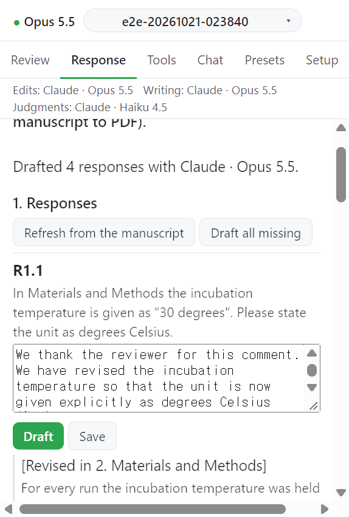

# Step 1. Responses

심사 의견마다 카드가 하나 있다. 답을 직접 쓰거나 **Draft** 로 초안을 받는다. 답하지 않을 의견이나 요청은 이유와 함께 거절한다.

## 동작

1. **Refresh from the manuscript** 를 누른다. 메시지: `Refreshed from the manuscript: n comments.`
2. 카드의 입력 칸에 답을 쓰고 **Save** 를 누른다. 메시지: `Saved R1.2.`
3. 초안을 받으려면 카드의 **Draft** 를 누른다. 메시지: `Drafted R1.2 with Claude · Opus 5.5.` 처럼 모델 이름이 붙는다.
4. 빈 카드를 한꺼번에 채우려면 **Draft all missing** 을 누른다. 모두 답했거나 거절했으면 `Nothing to draft: every comment has a response or is declined.` 가 뜬다.

## 카드에 보이는 것

| 부분           | 내용                                                                                                     |
| -------------- | -------------------------------------------------------------------------------------------------------- |
| 인용           | 수락한 변경에서 코드가 고른 인용문과 줄 번호. 원고에서 찾지 못하면 `Not located: ...`                    |
| 결정 대기      | 이 의견의 변경이 아직 Word 에서 결정을 기다리면 카드가 알린다                                            |
| 오래된 답      | 답을 쓴 뒤 원고가 바뀌면 카드에 표시된다. 다시 저장하거나 초안을 받는다                                  |
| 이전 답        | 기존 응답서에서 가져온 답이 있으면 `An answer from an earlier letter is kept and is given to the draft.` |
| 둘째 언어 문단 | 켜 두었으면 답 아래에 보인다. 번역이 빠졌으면 **Translate** 가 생긴다                                    |

## 거절하기

거절 이유는 응답서에 인쇄된다.

1. 의견 전체를 거절하려면 `Reason (printed in the letter)` 칸에 이유를 쓰고 **Decline this comment** 를 누른다. 이유가 없으면 `Write the reason first: it is printed in the letter.` 가 뜬다.
2. 수락한 변경이 없는 요청은 `<요청> ...: no accepted change` 줄로 뜬다. 그 줄의 이유 칸을 채우고 **Decline** 을 누르면 그 요청만 거절한다.
3. 거절한 카드에는 `Declined: <이유>` 와 **Undo decline** 이 보인다.

## 다음

→ [Step 2. Line numbers and checks](02-lines-checks.md)
