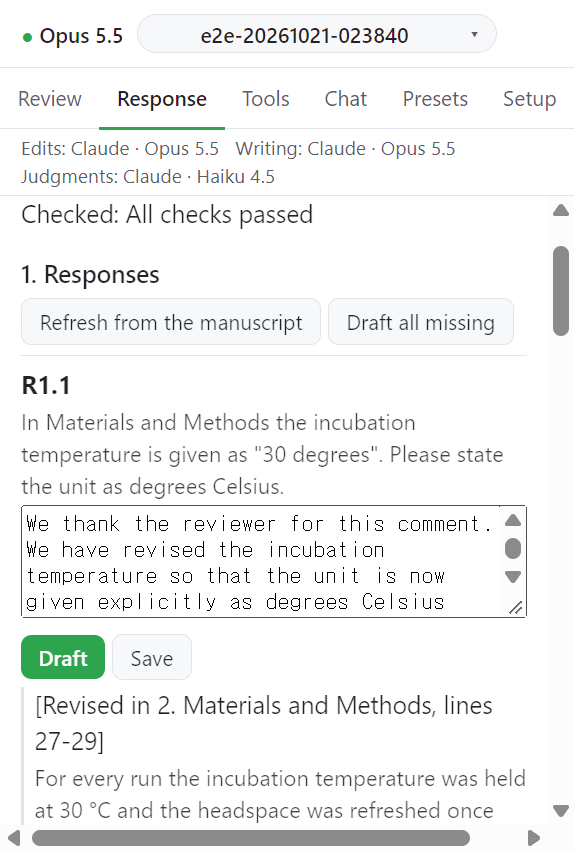

# Step 2. Line numbers and checks

인용문의 줄 번호를 원고에서 읽고 응답서를 검사한다.

## Update line numbers

1. Word 에서 연속 줄 번호를 켠다: Layout > Line Numbers > Continuous.
2. **Update line numbers** 를 누른다.
3. Word 가 원고를 PDF 로 만들고(`Rendering the manuscript to PDF in Word...`) 작업창이 여백의 줄 번호를 읽는다(`Reading the line numbers...`).
4. 끝나면 `Line numbers updated: n quotes located.` 가 뜬다.

줄 번호를 찾지 못하면 `No line numbers were found in the PDF. Turn on continuous line numbers in Word (Layout > Line Numbers > Continuous), then update again.` 가 뜬다.

줄 번호를 읽으려면 PyMuPDF 가 필요하다([요구 사항](../getting-started/requirements.md)).

## Run checks

**Run checks** 는 실패와 경고를 나눠 보여 준다. 메시지: `Checked: ...`

실패에 해당하는 예:

- 답하지 않은 의견
- 원고에 없는 인용문
- 원고보다 오래된 줄 번호
- 범위가 `Response letter` 인 장부 규칙 위반

모델이 판정하는 규칙은 이 탭에서만 검사한다. 검사가 실패하는 동안 내보내기는 보류된다([Export](03-export.md)).

## 다음

→ [Step 3. Export](03-export.md)
