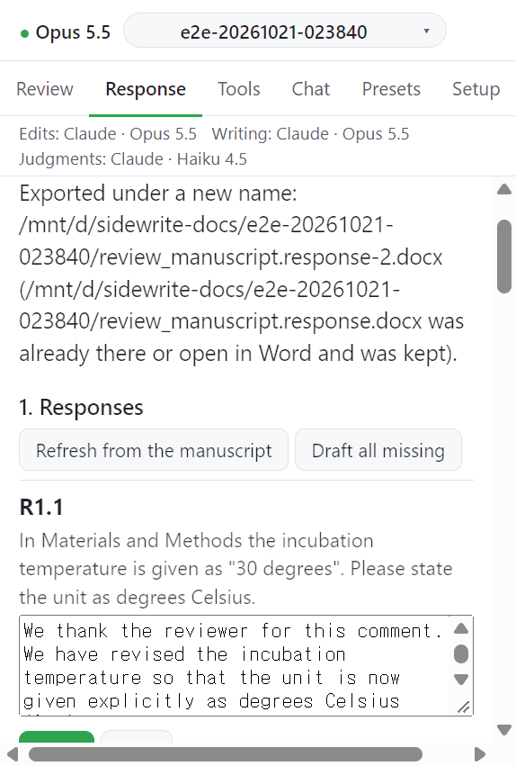

# Step 3. Export

응답서를 원고 옆에 새 파일로 쓴다.

## 동작

1. **Export letter (.docx)** 를 누른다. 메시지: `Exporting...`
2. 검사가 실패 중이면 `Not exported: ...` 와 함께 **Export anyway** 가 생긴다. 그대로 쓰려면 누른다.
3. 쓴 파일은 다시 읽어 검증한다. 마지막 내보내기는 `Last export: ...` 로 남는다.
4. 심사자별 일반 텍스트가 필요하면 **Export plain text per reviewer** 를 누른다.

## 쓰는 파일

| 파일                                   | 내용                                       |
| -------------------------------------- | ------------------------------------------ |
| `<원고 이름>.response.docx`            | 응답서                                     |
| `<원고 이름>.response.model.json`      | 쓴 그대로의 응답서 문단                    |
| `<원고 이름>.response.manuscript.json` | 인용문을 대조한 원고 문단                  |
| `<원고 이름>.response.R1.txt`          | 심사자 1 의 일반 텍스트. 편집자는 `.E.txt` |

기존 파일은 덮어쓰지 않는다. 이름이 이미 있거나 Word 에서 열려 있으면 `-2`, `-3` 을 붙이고 그렇게 했다고 알린다.

## 보충 파일이 있을 때

리비전에 보충 파일이 묶여 있으면 응답서의 위치 줄마다 파일 이름이 붙는다. 예: `Manuscript [Revised in Methods, lines 211-213]`, `Supplementary Information [Revised in Supplementary Methods]`. 보충 파일이 없는 원고의 응답서는 그대로다.

## 다음

→ [Profile and language](profile.md)
