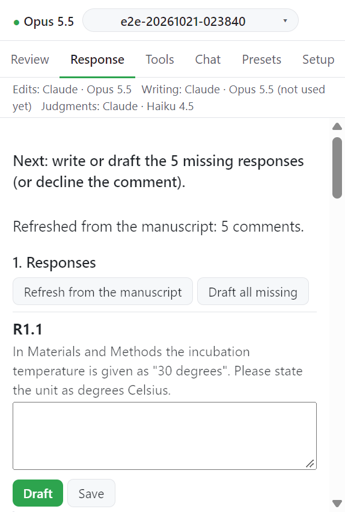

# 응답서: 한눈에 보기

Response 탭은 Review 탭의 심사 의견으로 항목별 응답서(point-by-point response letter)를 쓴다. 모델은 답의 문장만 쓴다. 어느 문장을 인용할지, 그 절과 줄 번호, 모든 검사는 Word 에서 수락한 변경으로 코드가 계산한다. 아직 결정하지 않았거나 거절한 변경은 인용하지 않는다.

```
1. Responses                 →  의견마다 답 쓰기 / Draft / Decline
2. Line numbers and checks   →  Update line numbers, Run checks
3. Export                    →  Export letter (.docx), 심사자별 텍스트
```



## 시작 전에

- Review 탭에서 의견을 나누고 변경을 제안받은 뒤 Word 에서 결정해 둔다([Word 에서 결정](../revision/04-decide.md)).
- 줄 번호를 쓰려면 Word 에서 연속 줄 번호를 켠다: Layout > Line Numbers > Continuous.
- 답 초안은 Setup 의 Writing provider 가 쓴다([Providers](../settings/providers.md)).

## 단계별 페이지

1. [Responses](01-responses.md)
2. [Line numbers and checks](02-lines-checks.md)
3. [Export](03-export.md)
4. [Profile and language](profile.md): 저널 프로필, 언어, 기존 응답서에서 색과 틀 가져오기

## 다음

→ [1. Responses](01-responses.md)
