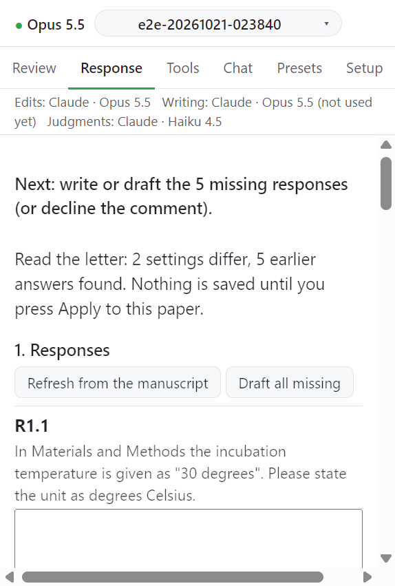

# Profile and language

응답서의 틀, 색, 제한은 저널 프로필(journal profile)에서 온다. 언어도 여기서 정한다.

## 프로필 찾는 순서

프로필은 `<이름>.json` 파일이다. 아래 순서로 찾는다.

1. 원고 옆 `journal_profiles/`
2. `CC_OFFICE_PROFILE_DIRS` 의 폴더들(`:` 로 구분)
3. `<CC_OFFICE_CONFIG_DIR>/journal_profiles/` (기본 `~/.claude/office-addins/journal_profiles/`)
4. 내장 `profiles/journal_profiles/` (`generic`, `example-elsevier`)

이름을 정하지 않은 논문은 `CC_OFFICE_PROFILE` (기본 `generic`)을 쓴다. 키 설명은 저장소의 `profiles/README.md` 에 있다.

## 입력

| 항목                                                | 내용                                   |
| --------------------------------------------------- | -------------------------------------- |
| 프로필 선택                                         | 찾은 프로필 목록. 아래에 경로가 보인다 |
| Response language                                   | 답의 언어                              |
| Rationale comment language                          | 근거 주석의 언어                       |
| Add a second-language paragraph under each response | 답 아래에 둘째 언어 문단을 붙인다      |
| Second language                                     | 둘째 언어                              |

답과 근거 주석은 프로필이나 논문이 따로 정하지 않으면 영어로 쓴다. 근거 주석의 기본 언어는 `CC_OFFICE_RATIONALE_LANG` 으로도 바꾼다.

## 동작

1. **Profile and language** 를 펼친다.
2. 프로필과 언어를 고친다.
3. **Save for this paper** 를 누른다. 메시지: `Saved for this paper: profile <이름>.`

이 논문의 값(프로필 이름과 override)은 `<원고 이름>.revision.json` 에 저장된다. 원고 옆 `submission.json` 에 같은 두 키가 있으면 대체값으로 쓴다.

## 기존 응답서에서 색과 틀 가져오기

1. **Take colours and frames from an existing letter** 아래에서 예전에 쓴 응답서 `.docx` 를 고른다.
2. 작업창이 읽고 다른 설정을 제안한다: `Read the letter: n settings differ, m earlier answers found. Nothing is saved until you press Apply to this paper.`
3. 제안 줄을 확인하고 **Apply to this paper** 를 누른다. 누르기 전까지는 아무것도 저장되지 않는다.

예전 응답서에서 찾은 답은 카드에 남고 초안에 전달된다.

프로필을 읽는 데 문제가 있으면 `Profile problem: ...` 이 뜬다.

## 다음

→ [제출 준비 개요](../submission/index.md)
