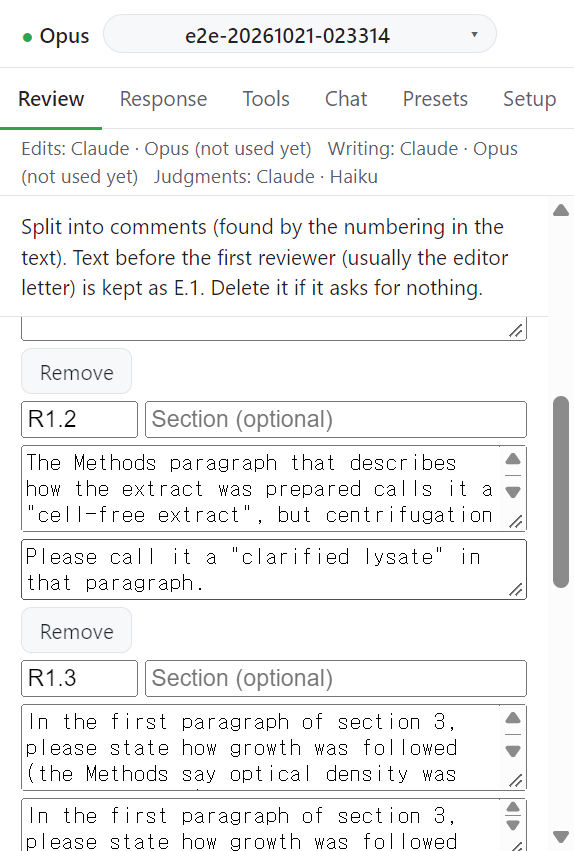
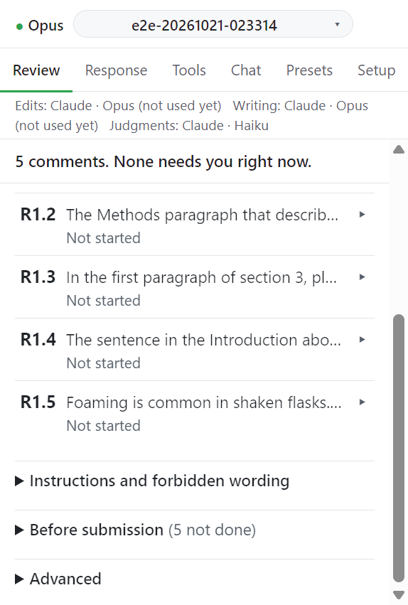

# Step 1. Reviewer comments

심사 의견 전문을 붙여넣고 의견 단위로 나눈다.

## 입력

| 항목      | 형식                                                                        | 필수                                         |
| --------- | --------------------------------------------------------------------------- | -------------------------------------------- |
| 심사 의견 | 붙여넣은 텍스트, 또는 **Load review from file** 로 고른 `.txt` / `.md` 파일 | 필수                                         |
| 의견 번호 | `R<심사자>.<번호>` 또는 편집자 의견은 `E.<번호>`                            | 분할이 채운다                                |
| Section   | 의견이 속한 부분 ("Abstract", "Round 2")                                    | 선택                                         |
| 요청      | 의견이 요구하는 것, 한 줄에 하나                                            | 선택. 비어 있으면 첫 제안 턴이 직접 나열한다 |

## 동작

1. **Reviewer comments** 칸에 심사 의견을 붙여넣는다. 파일에서 읽으려면 **Load review from file** 을 누른다.
2. **Split into comments** 를 누른다. 메시지가 나눈 방법을 알려 준다.
   - `found by the numbering in the text`: 본문의 번호와 배치로 나눴다.
   - `read by Claude`: 모델이 읽고 나눴다.
3. 나뉜 목록을 확인한다. 의견마다 번호, Section, 본문, 요청 칸을 고칠 수 있고 **Remove** 로 뺄 수 있다. 번호가 규칙에 맞지 않으면 `Bad ref "...": use R<reviewer>.<number> or E.<number>` 가 뜬다.
4. **Save comment list** 를 눌러 저장한다. 저장하기 전까지는 `Review split into n comments, not saved yet` 이 표시된다.
5. 저장하면 붙여넣기 칸은 한 줄로 접힌다. 원문을 다시 보려면 **Show review text** 를 누른다.

분할 결정은 원고 옆 `<원고 이름>.decisions.jsonl` 에 한 줄씩 기록된다. 입력 텍스트 대신 SHA-256 지문이 남는다. 이 파일은 언제 지워도 된다.

## 저장 뒤

**Comments** 절에 의견마다 카드가 생긴다. 카드 머리에는 번호, 첫 줄, 상태가 보인다. 카드를 누르면 펼쳐진다.

## 다음

→ [Step 2. Instructions and forbidden wording](02-ledger.md)
