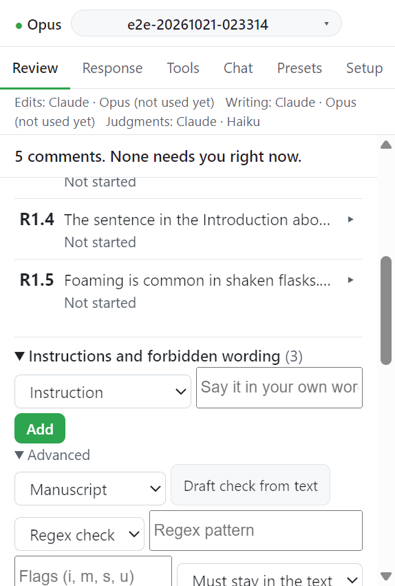

# Step 2. Instructions and forbidden wording

지시 장부(instruction ledger)는 이 원고에 적용할 규칙 목록이다. 지시(Instruction)는 턴에 전달되고 금지 표현(Forbidden wording)은 편집 전에 코드가 검사한다. 이 단계는 선택이며 언제든 추가할 수 있다.

## 입력

| 항목                            | 값                                                    | 필수              |
| ------------------------------- | ----------------------------------------------------- | ----------------- |
| Kind of rule                    | `Instruction` 또는 `Forbidden wording`                | 필수              |
| 규칙                            | 내 말로 쓴 규칙. 예: `do not write "novel"`           | 필수              |
| Scope (Advanced)                | `Manuscript`, `Response letter`, `Supplement`         | 선택              |
| 검사 방식 (Advanced)            | `Regex check` 또는 `LLM check`                        | 선택              |
| Regex pattern, Flags (Advanced) | 정규식과 플래그 `i`, `m`, `s`, `u`. 기본 플래그는 `i` | Regex check 일 때 |
| 판정 (Advanced)                 | `Match = violation` 또는 `Must stay in the text`      | 선택              |

## 동작

1. **Instructions and forbidden wording** 을 펼친다.
2. 종류를 고르고 규칙을 쓴 뒤 **Add** 를 누른다. Add 는 내 말로 검사를 만든다.
   - 따옴표 안의 구절은 쓴 그대로 찾는다. 메시지: `Rule added. It looks for "..." as written.`
   - 그 밖의 규칙은 Claude 가 읽고 판정한다. 메시지: `Rule added. Claude reads each paragraph to check it.`
3. 검사를 직접 정하려면 **Advanced** 를 펼친다. **Draft check from text** 가 쓴 문장에서 검사 초안을 만든다.
4. 규칙 줄의 **Edit** 로 규칙을 고친다.

LLM check 는 원고를 한 문단씩 읽는다. 문서 전체가 필요한 규칙(처음 나올 때 정의한 용어)은 이 방식으로 검사되지 않는다.

## 검사

| 버튼                           | 하는 일                          |
| ------------------------------ | -------------------------------- |
| Check all (changed paragraphs) | 바뀐 문단만 규칙에 비춰 검사한다 |
| Full check                     | 원고 전체를 검사한다             |

위반은 목록으로 뜨고 **Waiting for you** 상자에도 모인다. 분량 규칙(절 단어 수, 키워드 수, 그림과 표 수, 절 순서)은 Tools 탭에서 검사한다([Format and count checks](../submission/format-checks.md)).

## 장부 가져오기와 내보내기

| 버튼          | 하는 일                                                                                                      |
| ------------- | ------------------------------------------------------------------------------------------------------------ |
| Export ledger | 규칙만 원고 옆 `<원고 이름>.ledger.json` 으로 저장한다. id 와 검사 결과는 넣지 않는다                        |
| Import ledger | `.json` 장부를 읽는다. 이미 있는 규칙은 건너뛴다: `Added n ledger rule(s), skipped m already in the ledger.` |

## 심사 의견에서 규칙 제안 받기

1. **Suggest rules from the review** 를 누른다. 심사 의견에서 규칙 후보가 나온다.
2. 넣을 후보에 체크한다.
3. **Add selected** 로 넣거나 **Discard suggestions** 로 버린다. 체크가 없으면 `Tick at least one candidate rule.` 이 뜬다.

## 금지 표현에 막힌 편집

제안 턴의 편집이 금지 표현에 걸리면 편집은 적용되지 않는다. 카드에 `Blocked by <규칙>: "<새 텍스트>"` 가 뜬다.

- **Allow exception** 을 한 번 누르면 `Apply despite <규칙>?` 로 바뀐다. 한 번 더 누르면 예외로 적용한다.
- Word 가 답하지 않아 적용 여부를 모르면 **Re-apply anyway** 만 남는다. 두 번 적용될 수 있어 두 번 눌러야 실행된다.

거절한 변경 옆의 **Add to ledger...** 는 그 변경에서 규칙 초안을 만들어 장부 칸에 채운다. 고친 뒤 **Add** 를 누른다.

## 다음

→ [Step 3. Propose changes](03-propose.md)
