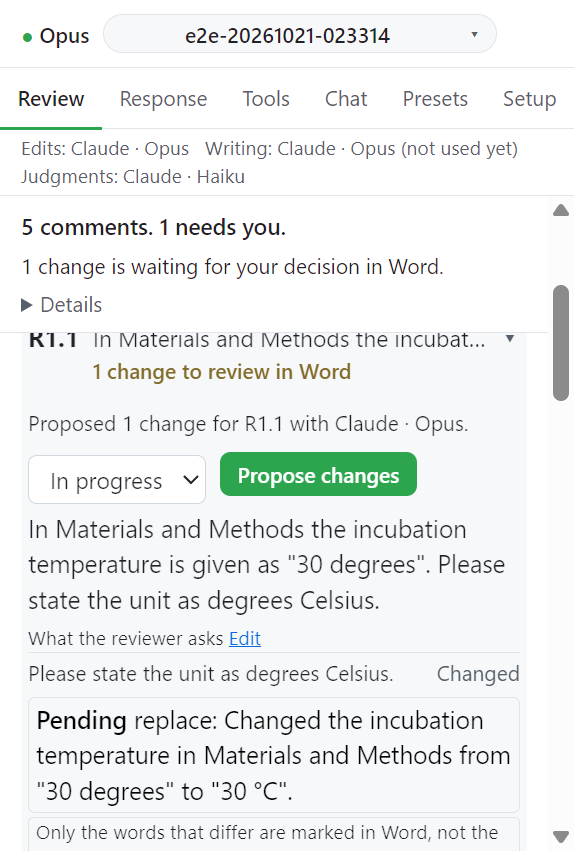
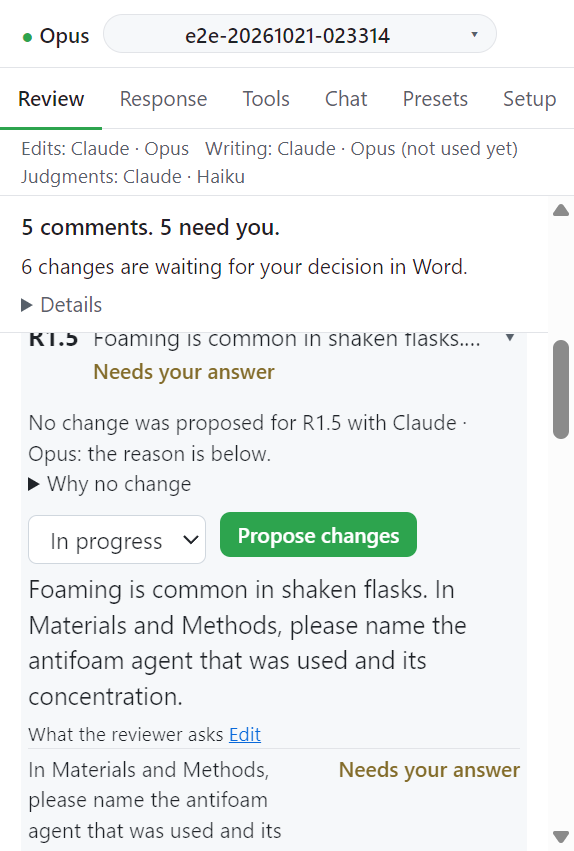

# Step 3. Propose changes

의견 하나를 골라 변경을 제안받는다. 변경은 Word 에 추적된 변경으로 들어가고 변경마다 근거 주석이 붙는다.

## 카드 구성

| 부분                     | 내용                                                                               |
| ------------------------ | ---------------------------------------------------------------------------------- |
| 상태 선택                | `To do`, `In progress`, `Done`                                                     |
| Propose changes          | 이 의견의 제안 턴을 시작한다                                                       |
| 요청 목록                | 의견이 요구하는 것과 그 상태. **Edit** 로 고치고 **Save requirements** 로 저장한다 |
| Questions for the author | 모델이 추측 대신 물은 질문                                                         |
| 변경 목록                | 이 의견이 만든 변경과 상태 배지                                                    |
| Advanced                 | **Preview prompt** 와 그 프롬프트                                                  |

## 동작

1. 카드를 펼치고 **Propose changes** 를 누른다. 메시지: `Review R1.2: proposing changes (tracked, one comment per change)...`
2. 카드에 `Working on this comment: <경과 시간>` 과 **Stop** 이 뜬다.
3. 턴이 끝나면 카드에 결과 한 줄이 남는다. 변경이 없으면 **Why no change** 를 펼쳐 이유를 본다.
4. 아직 변경이 없는 요청이 있으면 `n requests of R1.2 have no change yet: ...` 로 알린다.

턴에 보내는 문단을 보려면 카드의 **Advanced** 에서 **Preview prompt** 를 누른다. Propose changes 가 지금 보낼 프롬프트와 같다.

**More** 의 `Send the selected paragraphs with "Propose changes"` 를 켜면 Word 에서 선택한 문단을 함께 보낸다.

## 턴이 받는 것과 지키는 것

- 턴은 원고 전체(마지막 상태 갱신의 모든 문단), 의견, 그 요청, 다른 의견 개요를 받는다. 같은 세션의 다음 턴은 바뀐 문단만 받는다.
- 심사자가 언급한 단어가 있는 원고의 모든 자리(제목, 범례, Methods 포함)를 턴에 보여 준다.
- 고칠 곳이 셋 이상인 문단은 통째로 새로 써서 보낸다. 다른 단어만 추적된 변경이 되고 근거 주석은 문단에 하나다. 필드(참고문헌 관리기 인용), 그림, 각주가 있는 문단은 이 방식을 거부하고 문장 단위로 고친다.
- 근거 없는 주장이나 과장된 주장은 지우거나 관찰한 사실로 바꾼다. "may", "suggests" 를 덧붙이는 것으로는 부족하다.

## Questions for the author

변경이 아무 곳에도 없는 숫자를 쓰게 되면 그 변경은 거부된다. 바뀌는 텍스트, 그 문단, 의견, 작성자 지시, 작성자 답 어디에도 없는 숫자다. 이때 모델은 질문을 남긴다.

1. 카드의 **Questions for the author** 아래 질문과 `Why it is asked:` 가 보인다.
2. 답이 들어갈 문단이 있으면 `Where the answer goes:` 옆 링크로 그 문단을 연다.
3. 답을 쓰고 **Save answer** 를 누른다. 답은 다음 턴에 들어간다.
4. 같은 의견의 **Propose changes** 를 다시 누른다.

## 요청의 상태

| 표시                                          | 뜻                                   |
| --------------------------------------------- | ------------------------------------ |
| `Changed`                                     | 이 파일에서 바뀌었다                 |
| `Needs your answer`                           | 작성자 답을 기다린다                 |
| `In another file` / `In another file: <이유>` | 이 Word 파일 밖에서 답할 요청이다    |
| `Changed in a figure or other file`           | 그림이나 다른 파일에서 바뀌었다      |
| `A figure or file waits for your decision`    | 그림이나 파일 변경이 결정을 기다린다 |
| `Not yet`                                     | 아직 열려 있다                       |

## 이 파일 밖의 요청

대조군 곡선 추가처럼 그림으로 답할 요청이나 보충 표에 행을 더하는 요청은 Word 파일 밖의 일이다. 턴은 이런 요청을 `In another file` 로 기록한다. 이런 요청이 있는 카드에는 **Figures and other files** 버튼이 생긴다([Figures and other files](../submission/figures.md)).

## Propose all

1. **Comments** 절의 **Propose all** 을 누른다. 열린 의견을 차례로 제안한다.
2. 진행은 `Propose all: 2/5 R1.2.` 처럼 표시된다.
3. 멈추려면 **Stop after this one** 을 누른다. 돌고 있는 의견이 끝난 뒤 멈춘다.

열린 의견이 없으면 `No open comment to propose changes for.` 가 뜬다. 다른 턴이 돌고 있는 동안에는 새 턴이 시작되지 않는다.

## Done 표시

열린 요청, Word 에서 결정하지 않은 변경, 위반 중인 규칙이 남아 있으면 `Done` 을 고를 때 무엇이 남았는지 알린다. 그래도 Done 으로 하려면 한 번 더 고른다.

## 다음

→ [Step 4. Word 에서 결정](04-decide.md)
