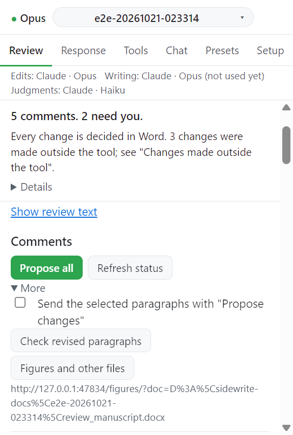

# Step 4. Word 에서 결정

제안된 변경은 Word 의 검토(Review) 기능으로 수락하거나 거절한다. Review 탭은 그 결정을 읽어 기록한다.

## 동작

1. Word 에서 변경을 하나씩 수락하거나 거절한다. 직접 고쳐도 된다.
2. 작업창의 **Refresh status** 를 누른다. 메시지가 수를 알려 준다: `Accepted a, rejected b, edited c, pending d, not found e.`
3. 카드의 변경 배지가 바뀐다.

작업창은 턴이 끝난 뒤와 작업창이 포커스를 다시 얻을 때 스스로 갱신한다. 결과는 **Advanced** 아래 한 줄에 `Auto-refreshed <시각>: ...` 로 남는다.

## 변경 배지

| 배지            | 뜻                             |
| --------------- | ------------------------------ |
| `Pending`       | Word 에서 아직 결정하지 않았다 |
| `Accepted`      | 수락했다                       |
| `Rejected`      | 거절했다                       |
| `Edited by you` | 내가 직접 고쳤다               |
| `Not found`     | 문서에서 그 변경을 찾지 못했다 |

변경 줄을 누르면 Word 에서 그 근거 주석이 선택된다. 줄에 마우스를 올리면 이유, 다루는 요청, 이전 문장과 바뀐 문장이 보인다.

Word 창이 최소화돼 있으면 Word 가 주석 추가를 거부한다. 추적된 변경은 들어가고 주석만 빠진다. 작업창은 주석을 다시 넣으려고 시도하고 그래도 빠진 변경에는 **Add rationale comment** 버튼이 생긴다.

## Waiting for you

**Waiting for you (n)** 상자에는 내가 볼 것이 모인다. 금지 표현에 막힌 편집, 위반 중인 규칙, 턴이 끝난 의견의 열린 요청이다. 줄을 누르면 해당 자리로 간다.

## Changes made outside the tool

마지막 갱신 이후 작업창 밖에서 문단이 추가, 삭제, 변경되면 **Changes made outside the tool (n)** 상자에 뜬다.

- 줄: `A paragraph was changed outside the tool: <문단>.`
- 이전 텍스트에 있던 사실(숫자 같은 것)이 새 텍스트에 없으면 그 사실을 적고 의도한 것인지 확인하라고 덧붙인다.
- 줄을 누르면 그 문단이 선택된다. 확인했으면 **Dismiss** 를 누른다.

## 도구 주석 정리

**Before submission** 을 펼치면 정리 버튼 두 개가 있다.

| 버튼                               | 하는 일                                                                                                     |
| ---------------------------------- | ----------------------------------------------------------------------------------------------------------- |
| Remove tool comments ([R...] only) | `[R<n>.<m>]` 로 시작하는 도구 주석만 지운다. 결과: `Tool comments a -> 0, your comments c -> c (unchanged)` |
| Delete ALL comments...             | 문서의 모든 주석을 지운다. 내 주석과 심사자 주석도 포함된다. 먼저 백업 파일을 쓴다                          |

### Delete ALL comments 의 순서

1. **Delete ALL comments...** 를 누른다. 버튼이 `Back up and delete n comments (tool t, yours u)` 로 바뀐다.
2. 한 번 더 누른다. 작업창이 주석을 다시 읽어 백업을 쓰고 백업한 주석 중 그사이 바뀌지 않은 것만 지운다.
3. 메시지 끝에 `Backup: <경로>` 가 붙는다. 백업은 원고 옆 `<원고 이름>.comments_backup.json` 이다. 이미 있으면 시각이 붙은 새 이름으로 쓴다.

처음 수를 보여 준 뒤 주석이 바뀌었으면 아무것도 지우지 않는다. 새 수를 보여 주고 다시 누르라고 한다.

!!! warning
주석을 지우고 저장하면 원고 파일이 바뀐다. 그 전에 만든 marked copy 는 오래된 것으로 표시된다. 정리하고 저장한 뒤 copy 를 만든다.

## 다음

→ [Step 5. Check revised paragraphs](05-check.md)
