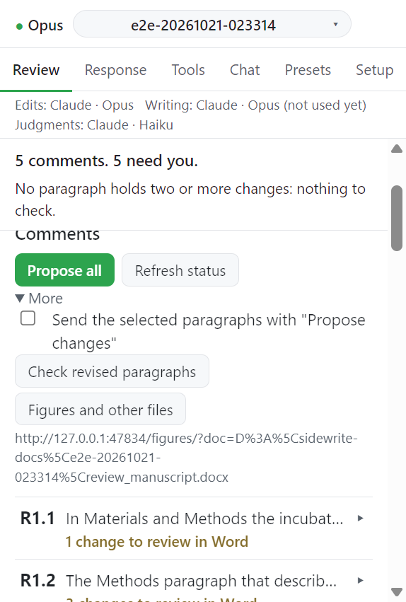

# Step 5. Check revised paragraphs

변경이 들어간 문단을 다시 점검하고 변경이 닿지 않은 다른 자리를 찾는다.

## Check revised paragraphs

1. **Comments** 절의 **More** 를 펼친다.
2. **Check revised paragraphs** 를 누른다. 메시지: `Checking the revised paragraphs...`
3. 찾은 것이 `<문단>: <내용>` 줄로 뜬다. 줄을 누르면 Word 에서 그 문단이 선택된다.

| 찾는 것                      | 줄의 내용                                                           |
| ---------------------------- | ------------------------------------------------------------------- |
| 문단 안의 모순               | `the paragraph contradicts itself.`                                 |
| 다른 의견의 변경끼리 충돌    | `changes of different comments work against each other.`            |
| 심사 의견을 출처로 삼은 문장 | `a sentence takes the review as its source.`                        |
| 철회한 주장이 남음           | `a claim a change withdrew is still made.`                          |
| 열린 질문에 기댄 문장        | `a sentence rests on what an open question to the author is about.` |

## Rewrite this paragraph

변경이 셋 이상 들어간 문단에는 **Rewrite this paragraph** 가 붙는다. 그 문단에 변경이 가장 많은 의견의 턴이 문단을 새로 쓴다. 다른 단어만 추적된 변경이 되고 근거 주석은 하나다. 메시지: `Review R1.2: rewriting <문단> (tracked)...`

## 카드에 남는 흔적

- 심사자가 언급한 단어가 아직 남아 있는 자리를 카드가 알려 준다.
- 언급한 단어가 없는 의견이면 변경이 지운 단어 중 다른 문단에 남은 것을 알려 준다.
- 링크를 누르면 그 문단으로 간다.

## Check other places

변경이 닿지 않은 자리가 있으면 카드에 **Check other places (n)** 이 생긴다.

1. 버튼을 누른다. 메시지: `Review R1.2: checking n other places (tracked)...`
2. 후속 턴은 목록에 오른 자리만 고칠 수 있다. 변경은 마찬가지로 추적된 변경과 근거 주석으로 들어간다.

후보에는 명명된 용어나 지운 주장 용어를 되풀이하는 Methods 문단과 그림/표 범례가 들어간다. 후보는 최대 20개, 40,000자다.

## 다음

→ [Step 6. Supplementary files](06-supplements.md)
