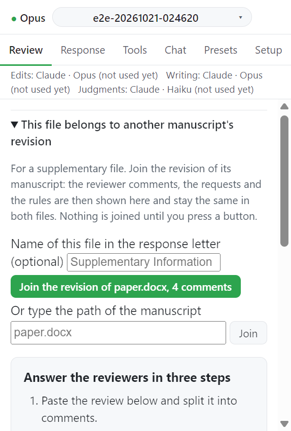

# Step 6. Supplementary files

보충 자료가 별도 Word 파일이면 그 파일을 원고의 리비전에 묶을 수 있다. 묶은 파일에서도 같은 의견 목록, 요청, 규칙으로 변경을 제안받는다.

## 입력

| 항목                                     | 값                                                                           | 필수                               |
| ---------------------------------------- | ---------------------------------------------------------------------------- | ---------------------------------- |
| 원고                                     | 같은 폴더의 원고 버튼, 또는 **Or type the path of the manuscript** 칸의 경로 | 필수                               |
| Name of this file in the response letter | 응답서가 이 파일을 부르는 이름. 예: `Supplementary Information`              | 선택. 비우면 확장자를 뺀 파일 이름 |

## 동작

1. 보충 Word 파일을 연다. 자체 심사 의견이 없으면 Review 탭에 원고 리비전에 묶는 접힘 상자가 뜬다. 상자 제목은 `This file belongs to another` 로 시작한다.
2. 같은 폴더에서 심사 의견을 가진 원고마다 버튼이 있다. 예: `Join the revision of paper.docx, 23 comments`.
3. 다른 곳의 원고면 경로를 쓰고 **Join** 을 누른다.
4. 버튼을 누르기 전까지는 아무것도 묶이지 않는다. 한 폴더에 논문이 둘 있을 수 있어서다.

## 묶은 뒤

- 보충 파일은 원고의 의견 목록, 요청, 규칙을 보여 준다. 고치는 곳은 원고뿐이다. 보충 파일은 작업창이 열릴 때마다 복사해 온다.
- 범위가 `Supplement` 인 규칙은 보충 파일에 적용된다. 원고의 단어 수, 절 수 규칙은 적용되지 않는다.
- **Propose changes**, **Propose all**, **Preview prompt** 는 원고에서와 같이 동작한다. 턴은 보충 파일만 읽고 고친다. 원고 텍스트는 받지 않는다.
- 한 파일에서 도구 질문에 답한 내용은 다른 파일의 턴에도 전달된다.
- 응답서 이름은 원고 줄의 **Name in the response letter** 와 **Save name** 으로 나중에 바꾼다.
- **Leave this revision** 으로 묶음을 푼다.

## 다른 파일의 상태

각 작업창은 다른 파일에서 요청이 어디까지 왔는지 보여 준다.

| 표시                                   | 뜻                           |
| -------------------------------------- | ---------------------------- |
| `Changed in SI.docx`                   | 그 파일에서 변경을 수락했다  |
| `Waiting for your decision in SI.docx` | 그 파일에서 아직 추적 중이다 |

이 상태는 그 파일의 마지막 상태 갱신이 쓴 값이다. Word 에서 수락하거나 거절한 뒤 그 파일의 작업창이 갱신되게 한다. 포커스를 얻으면 갱신된다.

## 응답서와 제출 점검

응답서는 원고에서 쓴다. 보충 파일의 Response 탭은 이 사실을 알리고 이 파일의 수락한 변경 중 응답서가 인용하는 것과 아직 인용하지 않는 것을 보여 준다. 원고의 "Run checks" 는 어느 파일이든 수락한 변경이 요청을 다루면 답한 것으로 센다.

닫힌 파일은 기록을 확인할 수 있을 때만 믿는다. 마지막 갱신이 저장된 문서에서 이뤄졌고 디스크의 파일 시각과 크기가 그대로여야 한다. 아니면 "Run checks" 가 실패한다.

- `SI.docx changed since Sidewrite last read it. Open it, save, press Refresh.`
- `SI.docx had changes that were not saved when Sidewrite last read it. Open it, save, press Refresh.`
- `Sidewrite has not read SI.docx since it joined this revision. Open it, save, press Refresh.`

## 알려진 한계

- 보충 파일의 인용문에는 줄 번호가 없다.
- 여러 파일을 합친 marked copy 는 없다.
- 클라우드에만 있는 문서는 묶을 수 없다.
- 묶은 뒤 이름을 바꾼 파일은 다시 찾지 못한다. 묶음을 풀고 다시 묶는다.
- Figures and other files 페이지는 보충 파일 아래에 새 기록을 받지 않는다. `Record this under paper.docx` 라고 답한다.

## 다음

→ [응답서 개요](../response/index.md)
