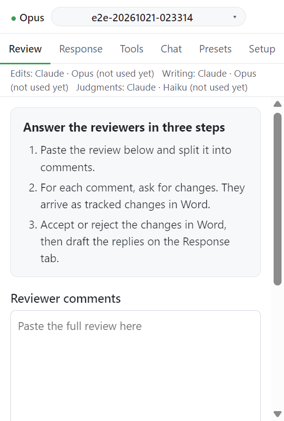

# 원고 리비전: 한눈에 보기

Review 탭은 심사 의견에 답하는 원고 수정을 단계별로 이끈다. 아직 의견을 나누기 전이면 탭 위쪽에 세 단계 안내가 뜬다.

```
1. Reviewer comments   →  심사 의견을 붙여넣고 의견 단위로 나누기
2. Ledger              →  지시와 금지 표현 규칙 (선택, 언제든)
3. Propose changes     →  의견마다 추적된 변경 + 근거 주석 제안
4. Word 에서 결정      →  수락 / 거절, Refresh status
5. Check               →  수정된 문단 점검, 다른 곳 점검
6. Response 탭         →  수락한 변경으로 응답서 작성
```



## 이 탭이 지키는 것

- 원고 변경은 모두 Word 의 추적된 변경으로 들어간다. 변경마다 근거 주석(rationale comment)이 하나씩 붙는다. 근거 주석은 `[R1.2]` 처럼 의견 번호로 시작한다.
- 수락과 거절은 사람이 Word 에서 한다. Review 탭은 그 결정을 읽기만 한다.
- 의견 목록, 변경 기록, 지시 장부는 원고 옆 `<원고 이름>.revision.json` 에 저장된다([원고 옆에 생기는 파일](../reference/files.md)).
- 원고 변경(Propose changes)은 Claude 만 맡는다. 의견 분할과 규칙 판정 같은 판단 작업은 Setup 의 Judgments provider 가 맡는다([Providers](../settings/providers.md)).

## 위쪽 줄

탭을 스크롤해도 위쪽 줄은 남는다. 처리가 필요한 의견 수, 진행 중인 작업, 마지막 메시지를 보여 준다. 메시지에 자세한 내용이 있으면 **Details** 를 펼친다.

## 단계별 페이지

1. [Reviewer comments](01-split.md): 붙여넣기와 분할
2. [Instructions and forbidden wording](02-ledger.md): 지시 장부
3. [Propose changes](03-propose.md): 변경 제안, 작성자에게 묻는 질문, 다른 파일의 요청
4. [Word 에서 결정](04-decide.md): 수락과 거절, Refresh, 도구 밖 변경, 주석 정리
5. [Check revised paragraphs](05-check.md): 수정 문단 점검, Rewrite this paragraph, Check other places
6. [Supplementary files](06-supplements.md): 보충 Word 문서를 원고 리비전에 묶기

## 다음

→ [1. Reviewer comments](01-split.md)
