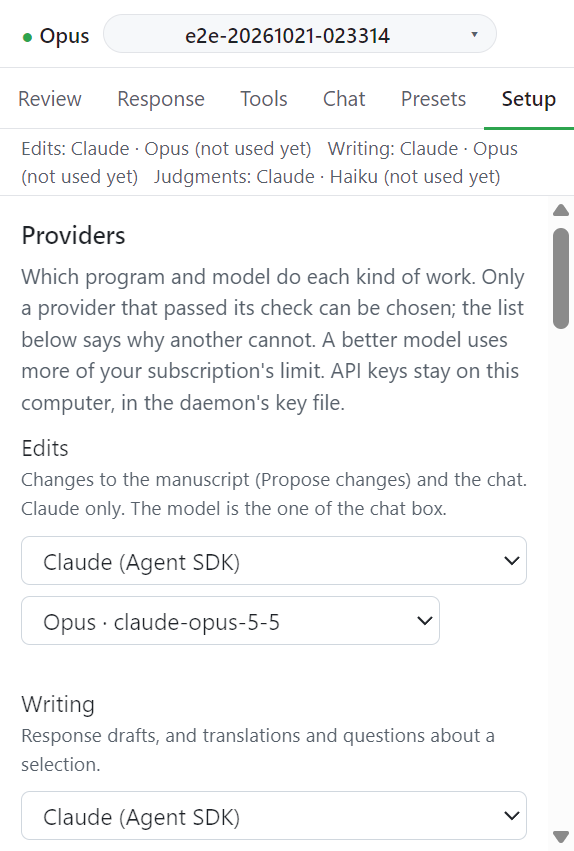

# Providers

Setup 탭의 **Providers** 절은 작업 종류마다 어떤 프로그램과 모델이 일할지 정한다. 검사를 통과한 provider 만 고를 수 있다. 아래 목록이 다른 provider 를 고를 수 없는 이유를 알려 준다. 이 절은 Word 작업창에만 있다.

## 작업 종류

| 행        | 맡는 일                                                                                       | provider     |
| --------- | --------------------------------------------------------------------------------------------- | ------------ |
| Edits     | 원고 변경(Propose changes)과 채팅. 모델은 채팅 입력 칸의 모델과 같은 값이다                   | Claude 만    |
| Writing   | 응답서 초안, 선택 영역 번역과 질문                                                            | 고를 수 있음 |
| Judgments | 심사 의견 분할, 요청 추출, 장부와 금지 표현 판정, 저널 지침 읽기. 빠르고 싼 모델이면 충분하다 | 고를 수 있음 |

고르기 전에는 Edits 와 Writing 이 계정이 나열하는 가장 좋은 Claude 모델(Opus, 없으면 Sonnet)을 쓰고 Judgments 는 Haiku 를 쓴다. 메뉴에서 고른 모델은 유지된다. 더 좋은 모델은 구독 한도를 더 쓴다. Opus 는 Sonnet 의 약 5배, Sonnet 은 Haiku 의 약 3~5배다.

## provider 목록

| 이름                                                                                             | 종류                                  |
| ------------------------------------------------------------------------------------------------ | ------------------------------------- |
| Claude (Agent SDK)                                                                               | 구독                                  |
| Codex CLI (ChatGPT sign-in)                                                                      | 구독                                  |
| Antigravity CLI (agy)                                                                            | 구독                                  |
| Ollama (local)                                                                                   | 로컬                                  |
| OpenRouter (incl. DeepSeek), DeepSeek, Groq, Mistral, Gemini API, OpenAI-compatible (custom URL) | API key. key 를 넣기 전에는 꺼져 있다 |

각 행은 상태를 보여 준다. 예: `Available for judgments.`, `Not available: <이유>`, `Off until you enter a key.`

provider 사이에 자동 대체는 없다. 고른 provider 를 쓸 수 없으면 오류가 되고 아무것도 보내지 않는다.

## API key

1. key 가 필요한 provider 행의 **API key** 칸에 key 를 넣는다.
2. **Save key** 를 누른다. 지우려면 **Remove key** 를 누른다.
3. **Check again** 으로 다시 검사한다.

key 는 이 컴퓨터의 daemon key 파일(`~/.claude/office-addins/provider-keys.json`)에 저장된다. 환경 변수 `CC_OFFICE_KEY_<ID>` 가 있으면 그쪽이 우선이다. key 는 작업창과 로그에 나오지 않는다.

## 저장된 선택 확인

작업창을 열면 daemon 이 저장된 provider 선택을 확인한다. 그동안 `Waiting for the daemon to confirm the stored providers. Judgments and review turns start after that.` 이 뜬다. 저장된 provider 를 쓸 수 없으면 그 이유를 알리고 여기서 다른 provider 를 고르라고 한다.

## 모델 줄

탭 아래 한 줄은 작업 종류마다 마지막으로 돈 모델을 보여 준다. 예: `Edits: Claude · Opus 5.5   Writing: Claude · Opus 5.5   Judgments: Claude · Haiku 4.5`. 메뉴의 선택이 아니라 provider 가 그 요청에 대해 보고한 모델이다. 다른 모델이 돌았으면 `asked for ..., ran on ...` 이라고 쓴다. 누르면 Setup 이 열린다. 결과 줄에도 모델 이름이 붙는다(`Drafted R1.2 with Claude · Opus 5.5.`).

## 다음

→ [Workspace and Context files](workspace.md)
