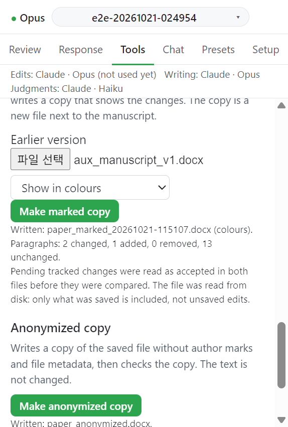

# Anonymized copy

저장된 파일에서 저자 표시와 파일 메타데이터를 뺀 copy 를 쓰고 검사한다. 본문 텍스트는 바뀌지 않는다.

## 동작

1. 원고를 저장한다.
2. **Make anonymized copy** 를 누른다. 메시지: `Writing and checking the anonymized copy...`
3. 성공하면 `Written: <원고 이름>_anonymized.docx.` 가 뜬다.
4. 검사 보고가 이어진다: `Verifier: total n left; text unchanged: ...; tracked changes unchanged: ...; structure intact: ...`

검사를 통과하지 못한 copy 는 `.INCOMPLETE.docx` 로 이름을 바꿔 둔다. 메시지: `The copy did not pass its check and was set aside as <이름>. Do not submit it.`

본문에 이름이 남아 있으면 `Still present` 아래 `The text still has the name "<이름>" (n times).` 로 알린다.

## 다음

→ [Before submission](before-submission.md)
