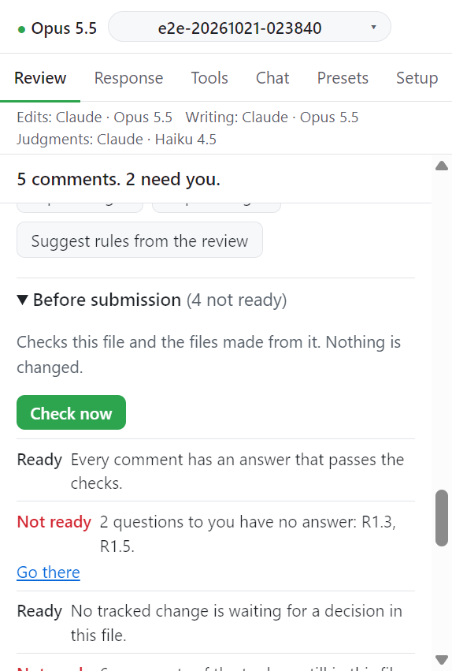

# Before submission

Review 탭 **Before submission** 절의 **Check now** 는 열린 파일에 남은 일을 나열한다. 아무것도 바꾸지 않는다. 모든 행은 논문 기록, 파일 해시, 지금의 문서로 계산한다. 나중 결정으로 오래된 응답서나 copy 는 준비되지 않음으로 나온다.

## 동작

1. **Before submission** 을 펼친다.
2. **Check now** 를 누른다. `Reading the document...`, `Checking...` 뒤 행이 뜬다.
3. 행마다 `Ready`, `Not ready`, `Not needed` 가 붙는다. 절 머리에는 `(n not ready)` 가 보인다.
4. `Not ready` 행의 버튼은 고칠 곳으로 데려간다.
5. 무언가 바꾼 뒤 **Check now** 를 다시 누른다.

## 행

| 행                                    | 읽는 곳                                                                                           |
| ------------------------------------- | ------------------------------------------------------------------------------------------------- |
| 모든 의견에 검사를 통과한 답이 있다   | 지금의 문서. 모델이 판정하는 규칙은 Response 탭에서만 검사하고 행이 그 수를 알린다                |
| 열린 요청이 없다                      | 문서에 맞춰 갱신한 기록. 수락한 변경이나 채택한 파일이 없는 요청, 답하지 않은 질문                |
| 기다리는 추적된 변경이 없다           | 지금의 문서                                                                                       |
| 도구 주석을 지웠다                    | 지금의 문서                                                                                       |
| 파일이 깨끗하다                       | 지금의 문서. 추적된 변경도 누구의 주석도 없다                                                     |
| Format and count checks               | 지금의 문서. 프로필에 서식 규칙이 없고 장부에 분량 규칙이 없으면 불필요                           |
| 응답서(.docx)가 지금의 답과 같다      | 내보낼 때 기록한 응답서 모델 해시와 지금 만든 모델, 파일 해시                                     |
| marked copy 가 저장된 원고와 맞다     | copy 를 만들 때 기록한 해시와 디스크의 copy, 저장된 원고                                          |
| 저널이 요구하면 anonymized copy       | 같은 방식. 프로필에 `submission.anonymized_copy: true` 일 때만. `false` 이거나 값이 없으면 불필요 |
| 채택한 그림과 파일이 제출 폴더에 있다 | 채택할 때 기록한 해시와 디스크의 copy. 아직 제안 상태인 변경이 있으면 준비되지 않음               |

## 저장하지 않은 변경

copy 두 행은 디스크의 파일을 비교한다. 작업창은 Word 에 저장하지 않은 변경이 있는지도 보낸다. 있으면 두 행이 `This document has changes that are not saved. Save it, then press Check now again.` 으로 나온다. Word 가 알려 주지 않으면 행은 그대로 계산하고 저장 여부를 확인하지 못했다고 덧붙인다.

이 해시를 기록하기 전에 만든 copy 나 응답서는 한 번 "make it again" 으로 나온다.

## 이 점검이 하지 않는 것

패키지를 만들지 않고 커버레터를 쓰지 않는다.

보충 파일이 묶여 있으면 결정 대기 변경, 도구 주석, 깨끗한 파일 행이 묶인 파일마다 한 번 더 나온다. 확인할 수 없는 파일은 `Open SI.docx and refresh: Sidewrite cannot confirm what it last read there (save the file first).` 로 나오고 준비되지 않음이다.

## 다음

→ [Figures and other files](figures.md)
