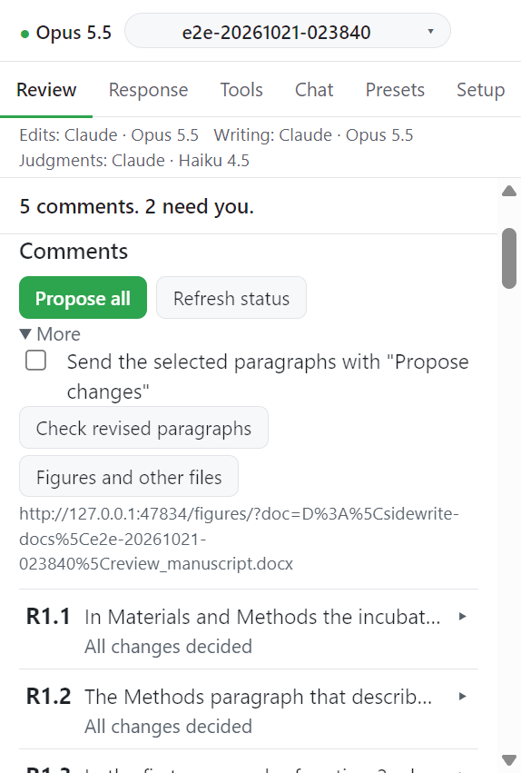

# Figures and other files

어떤 요청은 본문이 아니라 그림으로 답한다. 대조군 곡선 추가, 축 이름 변경, 새 패널 같은 것이다. 어떤 요청은 보충 파일로 답한다. 스프레드시트의 Table S3 에 행 추가, 고친 데이터 파일 같은 것이다. Review 탭은 이런 요청을 Word 파일 밖의 요청으로 표시하고 figures 페이지가 어느 파일이 답하는지 기록한다.

## 입력

| 항목        | 값                                                     | 필수             |
| ----------- | ------------------------------------------------------ | ---------------- |
| 답하는 요청 | 체크 상자                                              | 필수             |
| 라벨        | 원고가 부르는 이름. 예: `Figure 2`, `Table S3`         | 필수             |
| 이전 파일   | 원고 옆 `figures` 폴더에서 고르거나 전체 경로 붙여넣기 | 새 그림이면 없음 |
| 새 파일     | 같은 방식                                              | 필수             |
| 바뀐 점     | 한 문장                                                | 필수             |

`.ai` 원본이면 거기서 저장한 PDF 나 TIFF 도 지정한다. 그 파일이 보이고 제출된다. 원고 자체는 여기서 기록하지 않는다. 원고는 Word 에서 바꾼다.

## 동작

1. 그림이나 파일을 아무 도구로 고치고 새 이름으로 저장한다. 이전 파일은 그대로 둔다.
2. Word 에 원고를 열고 작업창이 연결된 상태에서 Review 탭의 **Figures and other files** 를 누른다.
   - 다른 파일의 요청이나 그림 변경이 있는 의견 카드에서 누르면 그 의견에서 열린다.
   - 원고 전체는 **More** 아래 버튼을 쓴다.
   - Word 는 페이지를 브라우저로 연다. 열지 못하면(Word on the web) 버튼이 일반 링크가 되고 주소가 아래에 적힌다. `http://127.0.0.1:47834/figures/` 를 직접 열어도 된다.
3. 의견 아래 **Add a figure or file change** 를 누르고 입력을 채운다.
4. 비교를 확인한다.
   - 그림: 두 파일을 나란히, 슬라이더 겹침, 차이 그림으로 보여 준다. 페이지 크기, 파일 형식, 실제 텍스트, 포함 글꼴도 보여 준다. 픽셀 크기가 다르면 알린다.
   - 그 밖의 파일(`.xlsx`, `.docx`, `.csv` 등): 이름, 크기, 형식만 보여 주고 `No preview for this file type` 이라고 쓴다. 두 파일을 직접 열어 보고 결정한다.
5. **Adopt** 또는 **Reject** 를 누른다.

## Adopt 가 하는 일

- 새 파일을 `figures/submission/` 으로 복사한다.
- `figures/submission/FILE_SOURCES.md` 에 한 행을 더한다. 그림, 의견, 원본 파일과 SHA-256, copy 와 SHA-256, 날짜다.
- 같은 이름이 이미 있으면 그대로 두고 copy 에 `-2`, `-3` 을 붙인다.
- 기록한 뒤 다시 저장된 파일은 거부한다. 새 이름으로 저장하고 그 파일을 기록한다.

## 응답서와의 연결

- 채택한 그림 변경은 체크한 요청의 답으로 센다. 초안은 바뀐 점으로 쓴 문장을 받는다.
- 응답서는 답 뒤에 한 줄을 넣는다: `[Revised Figure 2, file fig2_v2.pdf]`. 새 그림은 `[New Figure 3, file ...]`, 표는 `[Revised Table S3, file Table_S3_v2.xlsx]` 다.
- 아직 기다리는 그림 변경은 경고를 내고 그 요청은 열린 채 남는다.
- 채택한 copy 가 `figures/submission/` 에서 사라지거나 다른 파일이 되면 검사가 실패한다.
- 페이지에서 결정한 것은 열린 Word 작업창에 Refresh 없이 반영된다. 예: `1 figure or file waits for your decision`, `Changed in a figure or other file`.

## 쓰는 곳

Sidewrite 는 `figures/.renders/` (비교 그림, 내용 해시 이름), `figures/submission/`, `<원고 이름>.revision.json` 에만 쓴다. 지정한 그림 파일은 읽기만 한다. 페이지는 이 컴퓨터에서만, 실행 중인 daemon 의 token 으로만, 연결된 Word 작업창에 열린 원고에 대해서만 답한다.

## 필요한 것과 한계

- 비교 그림에는 PyMuPDF 가 필요하다(`pip install pymupdf`). 없으면 페이지가 알리고 기록과 채택은 그대로 된다.
- 그림이 보이는 형식: PDF, PDF 호환으로 저장한 `.ai`, SVG, PNG, JPEG, TIFF. 보충 PDF 는 첫 페이지를 보여 준다.
- 표나 다른 파일의 채택 copy 도 `figures/submission/` 에 들어간다. 보충 파일 전용 폴더는 아직 없다.
- 고를 수 있는 목록은 `figures` 폴더다. 다른 곳의 파일은 전체 경로로 지정한다.

## 다음

→ [Chat](../chat/index.md)
