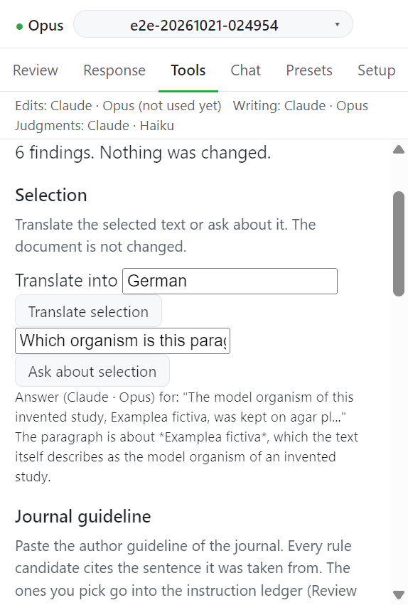

# Format and count checks

서식 규칙과 분량 규칙을 검사해 보고한다. 문서는 바뀌지 않는다.

## 검사하는 것

| 종류      | 출처             | 예                                                              |
| --------- | ---------------- | --------------------------------------------------------------- |
| 서식 규칙 | 프로필이 켠 규칙 | 통계 기호, 종과 유전자 이름의 이탤릭, 아래 첨자, 첫 줄 들여쓰기 |
| 빈 표     | 항상             | 내용이 없는 표                                                  |
| 분량 규칙 | 지시 장부        | 절 단어 수, 키워드 수, 그림 수, 표 수, 절 순서                  |

## 동작

1. **Run checks** 를 누른다. 메시지: `Reading the document...`
2. 찾은 것이 `Paragraph n: ...` 줄로 뜬다. 줄을 누르면 그 문단으로 간다.
3. 찾은 것이 없으면 `The checks found nothing.` 이 뜬다.

| 메시지                                                                 | 뜻                        |
| ---------------------------------------------------------------------- | ------------------------- |
| `Format rules on: ..., empty tables.`                                  | 켜진 서식 규칙            |
| `No format rule is on in the profile; only empty tables are reported.` | 프로필에 서식 규칙이 없다 |
| `No count rule is in the ledger.`                                      | 장부에 분량 규칙이 없다   |

스타일에서 온 이탤릭은 보지 못한다. 글자 자체에 준 이탤릭만 본다.

## 다음

→ [Marked copy](marked-copy.md)
