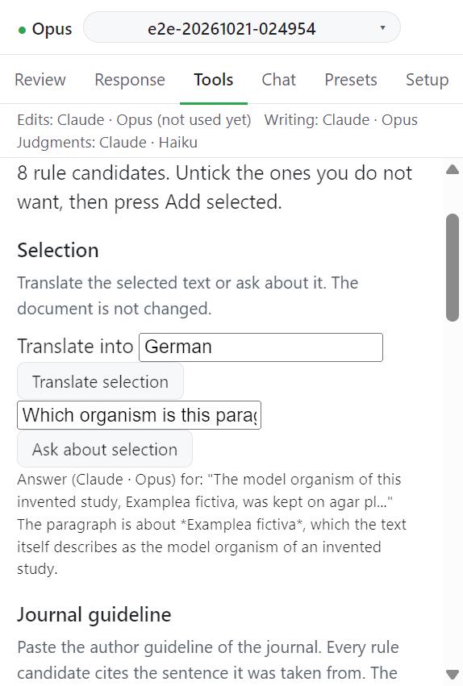

# Journal guideline

저널의 저자 지침을 붙여넣고 규칙 후보를 뽑는다. 후보마다 근거가 된 지침 문장을 함께 보여 준다.

## 동작

1. **Guideline text** 칸에 저자 지침을 붙여넣는다. 비어 있으면 `Paste the guideline text first.` 가 뜬다.
2. **Extract rules** 를 누른다. 메시지: `Reading the guideline...`
3. 후보 목록을 확인한다. 각 후보는 종류와 `Guideline: "<지침 문장>"` 을 보여 준다.
4. 남길 후보에 체크하고 **Add selected** 를 누른다. 체크가 없으면 `Pick at least one rule.` 이 뜬다.

## 후보의 종류

| 표시                    | 들어가는 곳                                                                  |
| ----------------------- | ---------------------------------------------------------------------------- |
| `Rule the model checks` | Review 탭의 지시 장부                                                        |
| `Count rule: ...`       | 지시 장부의 분량 규칙. [Format and count checks](format-checks.md) 에서 검사 |
| `Profile setting: ...`  | 이 논문의 프로필                                                             |

지침에서 규칙을 찾지 못하면 `No rule was found in the guideline text.` 가 뜬다. 모델 답을 읽지 못하면 아무 규칙도 넣지 않고 다시 실행하거나 손으로 넣으라고 한다.

## 리뷰 턴 범위 제한

체크 상자 `Review turns keep to what the reviewer asked (rules 2 to 4: nothing unrequested, no revision history in the text, facts only)` 는 이 논문의 리뷰 턴에 규칙 2~4 를 켜거나 끈다. 값은 프로필의 `policy_packs.review_scope` 에 저장된다.

| 상태 | 메시지                                                      |
| ---- | ----------------------------------------------------------- |
| 켬   | `Review turns keep to what the reviewer asked.`             |
| 끔   | `Review turns no longer carry rules 2 to 4 for this paper.` |

지침 읽기는 Setup 의 Judgments provider 가 맡는다.

## 다음

→ [Format and count checks](format-checks.md)
