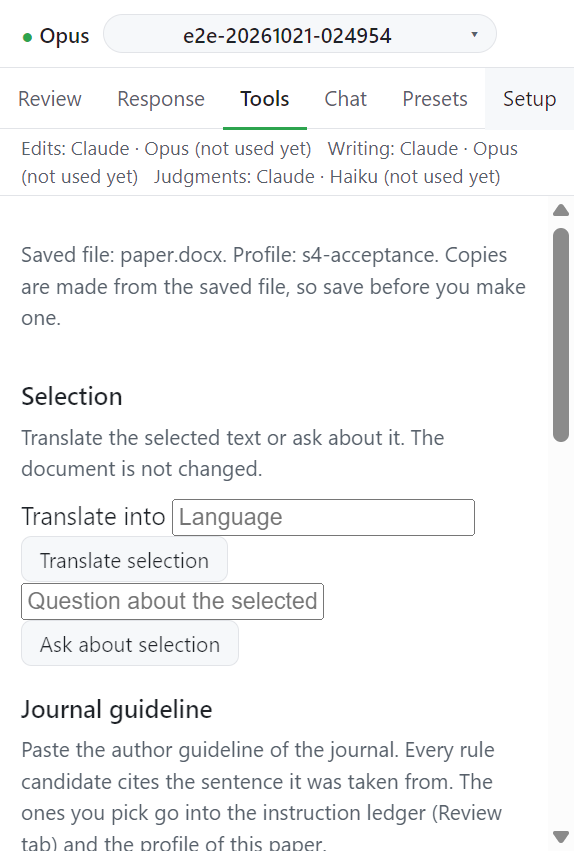

# 제출 준비: 한눈에 보기

Tools 탭은 열린 문서에 쓰지 않는다. copy 는 원고 옆의 새 파일이고 마지막으로 저장된 파일에서 만든다. copy 를 만들기 전에 저장한다.

탭 위쪽 줄이 대상 파일과 프로필을 알려 준다: `Saved file: <이름>. Profile: <프로필>. Copies are made from the saved file, so save before you make one.` 문서가 로컬 폴더에 저장돼 있지 않으면 `Save the document to a local folder to use the tools.` 가 뜬다.

| 절                      | 하는 일                          | 안내                                        |
| ----------------------- | -------------------------------- | ------------------------------------------- |
| Selection               | 선택한 텍스트 번역, 질문         | [Selection](selection.md)                   |
| Journal guideline       | 저자 지침에서 규칙 뽑기          | [Journal guideline](guideline.md)           |
| Format and count checks | 서식 규칙과 분량 규칙 보고       | [Format and count checks](format-checks.md) |
| Marked copy             | 이전 판과 비교한 표시본          | [Marked copy](marked-copy.md)               |
| Anonymized copy         | 저자 흔적과 메타데이터를 뺀 copy | [Anonymized copy](anonymized-copy.md)       |

Review 탭의 두 기능도 제출 준비에 속한다.

| 기능                          | 안내                                      |
| ----------------------------- | ----------------------------------------- |
| Before submission → Check now | [Before submission](before-submission.md) |
| Figures and other files       | [Figures and other files](figures.md)     |

## 다음

→ [Selection](selection.md)
