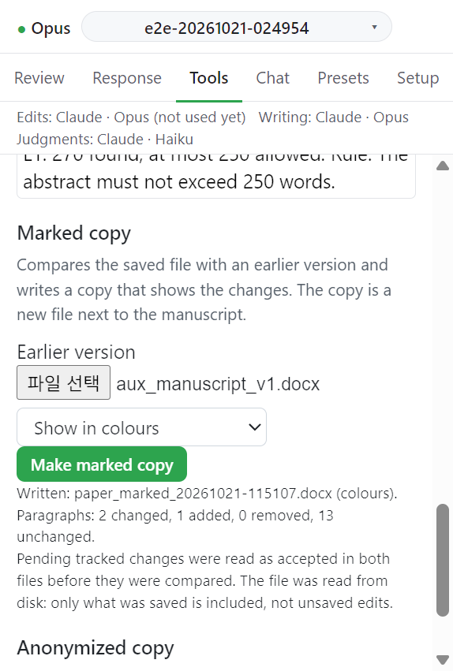

# Marked copy

저장된 원고를 이전 판과 비교해 변경을 보여 주는 copy 를 쓴다. copy 는 원고 옆의 새 파일이다.

## 입력

| 항목            | 값                                               | 필수 |
| --------------- | ------------------------------------------------ | ---- |
| Earlier version | 이전 판 `.docx`                                  | 필수 |
| 방식            | `Show as tracked changes` 또는 `Show in colours` | 필수 |

## 동작

1. 원고를 저장한다.
2. **Earlier version** 에서 이전 판을 고른다. 고르지 않으면 `Choose the earlier version (.docx) first.` 가 뜬다.
3. 방식을 고르고 **Make marked copy** 를 누른다. 메시지: `Comparing the saved file with <파일>...`
4. 결과는 `<원고 이름>_marked.docx` 다.

버튼은 저장소의 `tools/build_marked_diff.py` 를 그 스크립트의 옵션으로 실행한다. 스크립트를 직접 돌려도 같은 파일이 나온다. 도구가 거부한 내용은 도구가 쓴 그대로 문단 번호와 함께 보여 준다. Python 패키지 lxml 이 필요하다.

주석을 정리하고 저장하면 원고 파일이 바뀐다. 그 전에 만든 copy 는 [Before submission](before-submission.md) 에서 오래된 것으로 나온다. 정리, 저장, copy 순서로 한다.

## 다음

→ [Anonymized copy](anonymized-copy.md)
