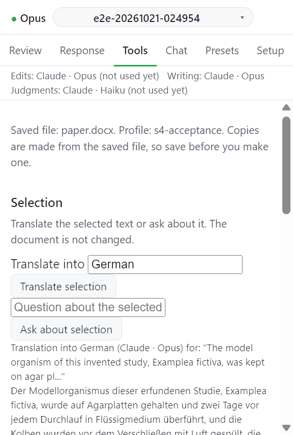

# Selection

선택한 텍스트를 번역하거나 그에 대해 묻는다. 문서는 바뀌지 않는다. 답은 탭에만 보이고 어디에도 저장되지 않는다.

## 입력

| 항목                             | 값          | 필수      |
| -------------------------------- | ----------- | --------- |
| Translate into                   | 번역할 언어 | 번역할 때 |
| Question about the selected text | 질문        | 물을 때   |

## 동작

1. Word 에서 텍스트를 선택한다. 선택이 없으면 `Select some text in the document first.` 가 뜬다.
2. 번역하려면 언어를 쓰고 **Translate selection** 을 누른다. 언어가 없으면 `Name the language to translate into.` 가 뜬다.
3. 물으려면 질문을 쓰고 **Ask about selection** 을 누른다. 질문이 없으면 `Type a question about the selected text.` 가 뜬다.

번역과 질문은 Setup 의 Writing provider 가 맡는다([Providers](../settings/providers.md)).

## 다음

→ [Journal guideline](guideline.md)
